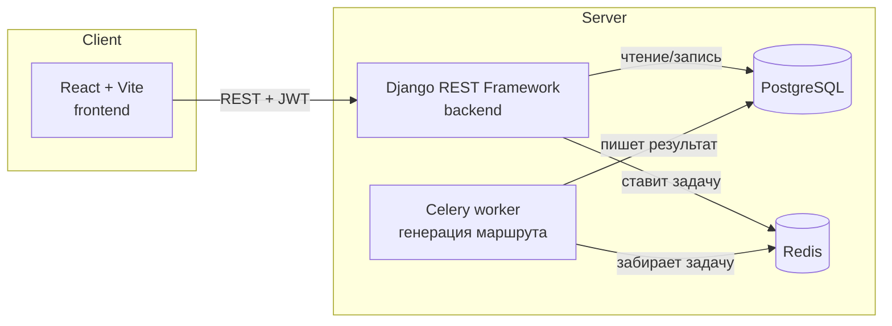
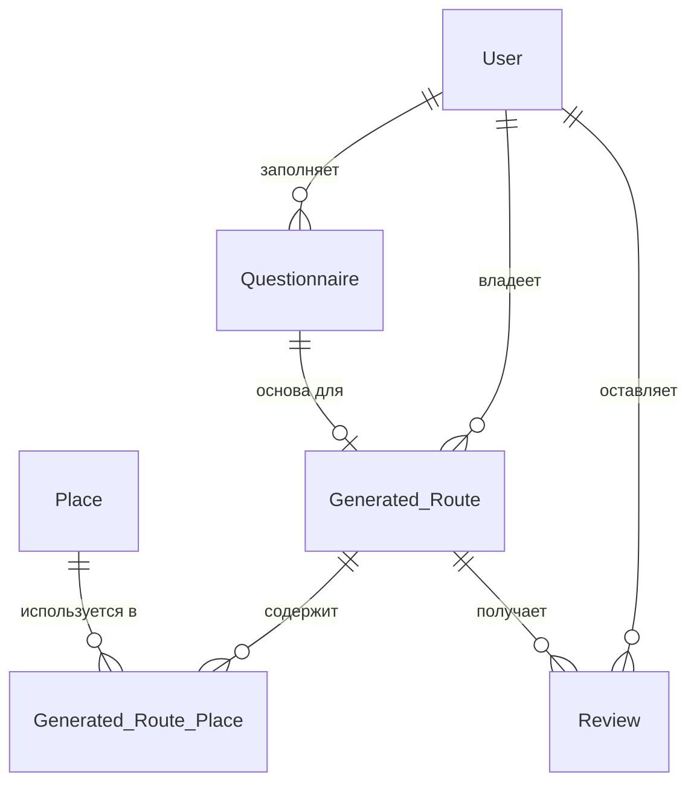

# Родной Код

Персональные культурные маршруты по регионам России. Пользователь заполняет анкету
о своих интересах и формате поездки — сервис подбирает маршрут из каталога мест
и собирает его в готовый план на несколько дней.

Проект в активной разработке: сейчас маршрут собирается алгоритмически из базы
проверенных мест, следующий шаг — подключение LLM для более гибкой генерации
(см. [Дорожную карту](#дорожная-карта)).

---

## Содержание

- [Стек технологий](#стек-технологий)
- [Архитектура](#архитектура)
- [Структура репозитория](#структура-репозитория)
- [Быстрый старт](#быстрый-старт)
- [Переменные окружения](#переменные-окружения)
- [API](#api)
- [Модель данных](#модель-данных)
- [Разработка](#разработка)
- [Безопасность](#безопасность)
- [Дорожная карта](#дорожная-карта)

---

## Стек технологий

**Backend**
- Python 3.12, Django 5, Django REST Framework
- PostgreSQL — основная база данных
- Redis + Celery — асинхронная генерация маршрутов
- JWT (`djangorestframework-simplejwt`) — авторизация

**Frontend**
- React 18, Vite
- React Router — маршрутизация
- Axios — HTTP-клиент с автообновлением JWT

**Инфраструктура**
- Docker / Docker Compose — единая среда для всех сервисов

---

## Архитектура



Создание маршрута не блокирует запрос пользователя: `POST /api/routes/` сразу
возвращает объект со статусом `pending`, а сама генерация происходит в фоне
через Celery. Фронтенд опрашивает `GET /api/routes/{id}/status/`, пока статус
не сменится на `ready` или `failed`.

---

## Структура репозитория

```
rodnoy-code/
├── backend/
│   ├── app/                  # основное Django-приложение
│   │   ├── models.py         # User, Questionnaire, Place, Generated_Route, Review...
│   │   ├── serializers.py
│   │   ├── views.py
│   │   ├── tasks.py          # Celery-задача generate_itinerary
│   │   └── urls.py
│   ├── rodnoycode/           # настройки Django-проекта
│   │   ├── settings.py
│   │   ├── celery.py
│   │   └── urls.py
│   ├── Dockerfile
│   ├── manage.py
│   └── requirements.txt
├── frontend/
│   ├── src/
│   │   ├── api/               # обёртки над каждым эндпоинтом backend
│   │   ├── context/           # AuthContext
│   │   ├── components/        # Header, Footer, ProtectedRoute, StatusBadge
│   │   └── pages/              # Landing, Register, Login, Questionnaire,
│   │                            # MyRoutes, RouteDetail, Profile
│   ├── Dockerfile
│   └── package.json
├── docker-compose.yml
├── .env.example
└── README.md
```

---

## Быстрый старт

### Требования

- Docker и Docker Compose
- Node.js 20+ (нужен только если запускаете frontend вне Docker)

### 1. Клонируйте репозиторий и настройте окружение

```bash
git clone <ссылка-на-репозиторий>
cd rodnoy-code
cp .env.example .env
```

Откройте `.env` и задайте свои значения — как минимум `DJANGO_SECRET_KEY` и `DB_PASSWORD`
(см. [Переменные окружения](#переменные-окружения)).

```bash
cd frontend
cp .env.example .env
cd ..
```

### 2. Запустите все сервисы

```bash
docker compose up --build
```

Поднимутся: PostgreSQL, Redis, Django backend, Celery worker, React frontend.

### 3. Накатите миграции и создайте администратора

```bash
docker compose exec backend python manage.py migrate
docker compose exec backend python manage.py createsuperuser
```

### 4. Откройте приложение

| Сервис            | Адрес                          |
|-------------------|--------------------------------|
| Frontend          | http://localhost:5173          |
| Backend API       | http://localhost:8000/api/     |
| Django admin      | http://localhost:8000/admin/   |

Чтобы генерация маршрутов работала не вхолостую, добавьте через `/admin/`
несколько тестовых записей `Place` с реальным полем `region`.

---

## Переменные окружения

### Корень проекта (`.env`) — backend и docker-compose

| Переменная            | Назначение                                  | Пример                  |
|-----------------------|----------------------------------------------|--------------------------|
| `DJANGO_SECRET_KEY`   | Секретный ключ Django (обязателен)          | сгенерировать случайно  |
| `DEBUG`               | Режим отладки (`0` на проде!)                | `0` / `1`                |
| `DB_NAME`             | Имя базы PostgreSQL                          | `rodnoy_db`              |
| `DB_USER`             | Пользователь PostgreSQL                      | `rodnoy_user`            |
| `DB_PASSWORD`         | Пароль PostgreSQL (обязателен)                | сгенерировать случайно  |
| `DB_HOST`             | Хост базы данных                             | `db`                      |
| `DB_PORT`             | Порт базы данных                             | `5432`                    |
| `REDIS_HOST`          | Хост Redis                                    | `redis`                  |
| `REDIS_PORT`          | Порт Redis                                    | `6379`                    |
| `ALLOWED_HOSTS`       | Разрешённые хосты Django (через запятую)     | `localhost,127.0.0.1`    |
| `CORS_ALLOWED_ORIGINS`| Разрешённые источники для CORS               | `http://localhost:5173`  |

### `frontend/.env`

| Переменная            | Назначение                                          | Пример                            |
|-----------------------|-------------------------------------------------------|-------------------------------------|
| `VITE_API_BASE_URL`   | Адрес backend API, доступный из браузера              | `http://localhost:8000/api`         |

Полный шаблон для обоих файлов — в `.env.example` и `frontend/.env.example`.
Реальные `.env`-файлы **никогда не коммитятся** — они в `.gitignore`.

---

## API

Базовый префикс: `/api/`. Авторизация — JWT (`Authorization: Bearer <access>`).

| Метод | Путь                          | Доступ           | Описание                                   |
|-------|-------------------------------|-------------------|---------------------------------------------|
| POST  | `/register/`                  | Открытый          | Регистрация, возвращает пару JWT-токенов    |
| POST  | `/token/`                     | Открытый          | Вход, возвращает пару JWT-токенов           |
| POST  | `/token/refresh/`              | Открытый          | Обновление access-токена                    |
| GET   | `/profile/`                   | Авторизован       | Данные текущего пользователя                |
| PATCH | `/profile/`                   | Авторизован       | Обновление профиля                           |
| GET/POST | `/questionnaires/`          | Авторизован       | Список/создание своих анкет                  |
| GET/POST | `/routes/`                  | Авторизован       | Список/создание своих маршрутов              |
| GET   | `/routes/{id}/`               | Авторизован (владелец) | Детали маршрута с местами по дням       |
| GET   | `/routes/{id}/status/`        | Авторизован (владелец) | Статус генерации (`pending/ready/failed`) |
| GET   | `/places/`                     | Открытый          | Каталог мест (пагинация)                     |
| GET   | `/filter-places/`              | Открытый          | Фильтр мест по региону/интересу              |
| GET/POST | `/reviews/`                  | Авторизован       | Список/создание своих отзывов                |

Списковые эндпоинты используют пагинацию DRF — ответ приходит в виде
`{ "count": ..., "next": ..., "previous": ..., "results": [...] }`.

---

## Модель данных



---

## Разработка

### Ветвление и Pull Request

- `main` — всегда стабильная ветка, прямые пуши в неё закрыты.
- Новая задача — новая ветка от актуального `main`: `feature/...`, `fix/...`.
- Изменения проходят через Pull Request с ревью перед мержем.

### Полезные команды

```bash
# Логи конкретного сервиса
docker compose logs -f backend
docker compose logs -f celery

# Миграции после изменения models.py
docker compose exec backend python manage.py makemigrations app
docker compose exec backend python manage.py migrate

# Django shell
docker compose exec backend python manage.py shell

# Прогнать проверки Django перед коммитом
docker compose exec backend python manage.py check
```

### Frontend отдельно от Docker (быстрее для правки UI)

```bash
cd frontend
npm install
npm run dev
```
Backend при этом всё равно должен быть поднят (`docker compose up db redis backend celery`).

---

## Безопасность

- Все чувствительные данные — только в `.env`, никогда не коммитятся.
- JWT-токены живут ограниченное время, обновление — через refresh-токен.
- Владение объектами (анкеты, маршруты, отзывы) проверяется на уровне
  сериализаторов и `get_queryset()` — пользователь не может прочитать
  или изменить чужие данные (защита от IDOR).
- `DEBUG=0` и реальный `DJANGO_SECRET_KEY` обязательны при любом деплое
  за пределами локальной машины.

Если находите уязвимость — не создавайте публичный issue, сообщите напрямую
кому-то из команды.

---

## Дорожная карта

- [x] Регистрация, JWT-авторизация
- [x] Анкета и алгоритмический подбор маршрута
- [x] Асинхронная генерация через Celery
- [x] Фронтенд на React с полной интеграцией API
- [ ] Генерация маршрута через LLM поверх каталога `Place`
- [ ] Загрузка фото к отзывам через интерфейс
- [ ] Production-конфигурация (Gunicorn, non-root контейнеры, HTTPS)
- [ ] Автотесты (backend и frontend) + CI

---

## Лицензия

Проект пока без публичной лицензии — все права защищены авторами проекта.